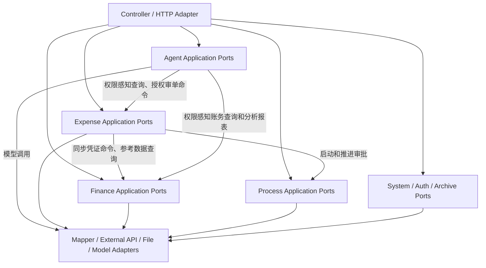

# FinEx 报销与财务协同系统最终目标与开发架构规范

**文档版本**：v2.5
**生效日期**：2026-10-02
**状态**：Active  
**审查基线**：当前工作区，包括尚未提交、未跟踪的 Agent 与业务改动  
**审阅周期**：每季度，或重大边界/安全变更完成后立即复查  

---

## 一、文档定位与状态定义

本文档是 FinEx 的最高产品架构与开发约束。它定义最终目标、当前事实、演进边界和质量门禁，但不把尚未实现的设计写成已经存在的能力。

文中使用以下状态：

| 状态       | 含义                    |
| -------- | --------------------- |
| **当前事实** | 已由当前代码、配置、数据库脚本或测试证明  |
| **目标架构** | 系统要演进到的状态，不代表已经实现     |
| **强制规则** | 所有新增和修改必须遵守；遗留例外需显式记录 |
| **触发条件** | 只有条件成立并形成决策记录后才实施     |

文档优先级：

```text
本规范
  ├─ 指导：当前实现架构图与演进路线图
  ├─ 指导：项目长期架构治理工作流
  └─ 指导：各专项审查和治理方案
```

若专项文档与本规范冲突，以本规范为准；若本规范与实际代码不一致，必须明确记录为“目标”或修正文档，禁止用文档覆盖事实。

---

## 二、产品目标与范围

### 2.1 产品愿景

FinEx 面向 50～500 人的中小企业，提供报销、审批、付款、凭证、总账、固定资产、档案和智能协助的一体化能力，预留因使用人数增加同步升级系统的能力。

核心价值：

1. 报销申请、审批、付款和凭证生成形成可审计闭环。
2. 报销与财务共享明确的数据契约，不重复维护业务真相。
3. 流程和表单可配置，但配置不能绕过权限和业务不变量。
4. Agent 作为智能增强层，通过受控工具使用业务能力，不直接操作业务数据库。

### 2.2 核心域

#### Expense：报销管理

- 报销单创建、草稿、提交、审批、撤回、支付和异常处理。
- 报销明细、附件、OCR、发票、收款方、关联与核销。
- 报销付款和凭证推送编排。
- 报销查询、统计和用户可见范围。

#### Finance：财务管理

- 凭证录入、保存、审核、记账、冲销和归档。
- 账套、会计期间、期初余额、期末结转。
- 总账、明细账、序时账、辅助账、往来、报表及其指标计算口径。
- 固定资产、财务档案、科目、客户、供应商和项目。

#### Process：业务审批与表单流程

- 流程模板、版本、节点、路由和审批人解析。
- 表单、费用明细和自定义档案设计。
- 审批任务、抄送、付款节点及业务状态流转。

#### Agent：智能增强

- Agent 定义、版本、发布、运行和日志。
- 对话、模型任务编排、受控工具调用、数字员工及经审核的产品运行时 Skill。
- 外部模型调用前的数据脱敏与结果还原。
- 企业知识库和业务本体属于目标能力，未落地部分不得标记为已完成。

#### System/Auth/Archive：系统支撑

- 公司、部门、员工、角色、权限、配置和通知。
- 登录、JWT、用户身份和权限校验。
- 发票、文档、打印、下载和归档。

### 2.3 明确不做或暂不做

- 当前不做多租户 SaaS；部署级 `tenantId` 不得代替公司级数据隔离。
- 当前暂不拆分业务微服务。
- 当前暂不建设采购、库存、销售、薪酬或合同全业务套件。
- 当前不合并 Process 审批工作流和 Agent 工具/LLM 工作流。
- 当前不因“技术先进”而默认引入 Redis、RabbitMQ、Kafka 或 APM 产品。

### 2.4 非功能目标

以下为目标，不代表已经通过压测或监控证明：

| 维度   | 目标               |
| ---- | ---------------- |
| 峰值请求 | 50 QPS           |
| 页面首屏 | 正常网络与目标终端下小于 2 秒 |
| 常规接口 | P95 小于 500ms     |
| 万级报表 | 小于 5 秒，超出时采用异步下载 |
| 可用性  | 月度 99.9%         |
| 数据   | 核心事务不丢失，可审计、可追查  |

任何性能结论必须注明数据量、环境、查询、并发和采样时间。

---

## 三、当前架构事实与目标架构

### 3.1 当前事实

当前仓库包含 Maven 父工程、`common`、`gateway` 和承载绝大部分业务的 `auth-service`。业务代码主要仍按 `controller/service/dto/entity/mapper` 技术层组织，Expense、Finance、Process、Settings 等真相集中在 `service.impl` 的逻辑子包中。

因此当前最准确的定义是：

> 单一业务部署模块中的逻辑分域，正在演进为可验证的模块化单体。

当前还不能宣称已经完成：

- 独立的领域 Maven 模块。
- 完整的 `domain/application/infrastructure` 包隔离。
- 自动化的领域无环依赖检查。
- 可量化的 70% 测试覆盖率。
- Redis、消息队列或全局 APM。

### 3.2 目标架构



目标是清晰端口和单向依赖，不是为了形式创建大量空接口。已有能力型 Service 可以直接承担应用端口，只有在跨域依赖或适配器替换需要时才新增端口。

### 3.3 演进原则

- 保持单部署和数据库事务优势，先把逻辑边界变得可验证。
- 新业务进入明确 owner；遗留大入口保持稳定，对仍在其中的运行态职责按可验证切片逐步提取，避免继续堆积无关业务规则。
- 每次只迁移一个可验证切片，不进行大爆炸式包迁移或领域重写。
- 对外 API、数据库结构、权限码和用户流程默认保持向后兼容；可经迁移和验证增加接口、权限码与数据库字段。破坏性变更须单独决策、回归和回滚。
- 只有真实部署和团队边界需要独立发布时，才评估微服务。

---

## 四、领域职责与公共接口

### 4.1 使用现有能力型接口

当前公共边界以真实存在的接口为准：

| 领域      | 代表接口                              | 主要职责              |
| ------- | --------------------------------- | ----------------- |
| Expense | `ExpenseDocumentService`          | 报销单、审批、支付相关应用入口   |
| Expense | `ExpenseVoucherGenerationService` | 报销凭证映射、推送和查询      |
| Finance | `FinanceVoucherService`           | 凭证查询、保存、审核、记账     |
| Finance | `FinanceContextService`           | 公司、账套和期间上下文       |
| Finance | `FinanceOpeningBalanceService` 等  | 按财务能力拆分的应用接口      |
| Process | `ProcessFlowDesignService`        | 流程设计与发布           |
| Process | `ProcessManagementService`        | 模板、费用类型和流程管理      |
| Agent   | `ArchiveAgentService`             | Agent 定义、发布、运行和记录 |

禁止为了文档对称性创建宽泛的 `ExpenseService`、`FinanceService`、`ProcessService` 或 `AgentService` 巨型门面。

### 4.2 Expense 边界

Expense 拥有：

- 报销单、明细、附件、支付、关联、核销和报销状态。
- 报销可见范围和审批/支付应用编排。
- 报销凭证映射规则和推送批次记录。

Expense 可以：

- 调用 Process 端口启动或推进审批。
- 调用 Finance 同步命令创建凭证。
- 调用 Finance 查询端口获取科目、项目等参考数据。

Expense 不可以：

- 直接读写 Finance Mapper 或表。
- 绕过 Process 任意修改审批任务状态。
- 复制 Finance 的凭证校验和编号规则。

### 4.3 Finance 边界

Finance 拥有：

- 凭证及凭证行、账套、期间、科目、余额、账簿和财务档案。
- 凭证编号、平衡、审核、记账和关账规则。

**总账共享余额口径：** `gl_accsum`、`gl_accass` 的本币及外币期初/期末净额统一以借方为正、贷方为负；期末净额＝期初净额＋本期借方发生－本期贷方发生。借贷发生额保留凭证原列的符号：借方负数抵减借方，贷方负数抵减贷方，本期发生额可以为负；数量发生额同理。资产、负债、权益、成本、损益五类科目使用同一计算式；科目默认余额方向仅用于期初录入提示和兼容转换，不决定计算或实际余额方向。报表与账簿只将期初、期末净额拆成非负的借方、贷方余额，零余额两列均为零。父科目从直接子科目逐级汇总净额后再拆方向；筛选后的类别合计只取命中范围内最上层科目，每个子树计算一次，辅助明细不重复计入。期初录入接口保留相对科目默认方向的正负输入约定，在 Finance 边界转换为共享净额口径。

**普通明细账口径：** 按会计期间起止及任意级次科目的编码范围查询；命中父科目即包含其全部下级，一级科目分别成区块，边界区块只统计命中范围。首月期初从命中范围内最上层科目的快照汇总，父子快照不得重复计入；区块内按制单日期、凭证号、分录序号逐笔更新借方为正的净余额。发生额保留原借贷列及符号，余额只显示非负金额和实际方向。每个会计月都有本月合计，区块有期初和期末余额；分页按凭证分录，跨页以承前余额衔接，导出全量并保持区块顺序。辅助项仅作为展示列，名称、编码、编码+名称复用余额表维度顺序和 `*` 分隔符。八种账簿页面的科目范围选择器复用新建凭证的科目树；余额表、总分类账及专门明细账保持各自原有后端范围口径。明细账页面必须在用户点击查询后才请求数据；切换公司或重置后清空旧结果。

**账簿期间范围与辅助项：** 余额表、普通明细账、总分类账及项目、供应商、客户、个人、数量金额明细账共用会计月起止校验，允许跨年但不得超出账套期间。总分类账和专门明细账的期初取起始月余额快照，按会计期间、制单日期、凭证号、分录序号累计范围内发生额；原有分组保持不变，跨月用一行“期间合计”，单月用“本月合计”。总分类账页面不提供辅助筛选；项目明细账只筛项目分类、项目，供应商、客户、个人明细账各只筛对应维度。四种辅助明细账的过滤器留空表示该维度全部有编码的历史记录，含已停用辅助项；项目分类和项目均可留空。数量金额明细账使用共享辅助项展示模式，逐笔行可显示名称、编码、编码+名称，汇总行辅助项留空；页面查询与导出不发送隐藏筛选条件，旧接口直接调用仍按原有筛选规则处理。旧版年度、月份参数仍表示单月；序时账继续只接受单月。

**期末结转发生额口径：** 损益和自定义结转以借、贷原列带符号发生额取数。结转净额由负数原列促成时，预览、运行明细和凭证均保留该列的负数表达；例如损益借方发生 `-100` 时，结转凭证记损益贷方 `-100`、目标科目借方 `-100`。来源科目净额归零，目标科目承接同额净额；零净额不生成分录。结转明细金额允许为负，“生成总金额”按明细绝对金额合计。按期末余额结转的规则继续使用余额方向和非负余额。

Finance 不直接修改报销单。创建凭证成功后的通知、审计和统计可以通过提交后事件完成，但核心凭证创建保持同步，确保调用方立即获得明确结果。

### 4.4 Process 边界

Process 拥有审批流程模板、版本、节点、路由、审批人解析和任务状态。Process 可以回调业务端口或返回状态迁移结果，但不得直接修改 Expense/Finance 业务表。

Process Workflow 与 Agent Workflow 保持独立：

- Process 的节点具有审批、抄送、付款、人员解析和业务状态语义。
- Agent 的节点具有 LLM、工具、条件和运行上下文语义。
- 两者只能复用不含业务语义的图校验、拓扑和画布基础能力。
- Process 可通过受控触发契约挂接固定版本的 AI 审单能力；由边界适配层协调执行和结果交付，不形成两个工作流引擎的业务实现依赖。

### 4.5 Agent 边界

Agent 是智能增强层，不是独立产品，也不是业务数据超级管理员。

强制规则：

- Agent Tool 通过受控应用端口访问业务数据。
- Agent Tool 不依赖 Expense、Process、Finance Mapper 或业务 Entity。
- 查询端口在服务端执行用户、公司、权限、所有权和软删除过滤。
- 查询 Tool 返回最小化读模型，模型输入再按字段规则执行必要脱敏。
- 操作 Tool 使用独立的业务操作授权、状态校验和审计；数字员工分配与查询权限不授予写入权。
- Agent 不绕过 Process 修改审批状态，不绕过 Finance 创建或修改凭证。
- Agent 自身定义、版本、运行和会话可以使用 Agent 域内 Mapper。

**权限感知查询边界（目标规则，分阶段落地）：** FinWork 只调动提问者获分配的数字员工所绑定、已发布的固定版本工作流；每项查询分别取提问者、责任人、员工配置、工具与业务数据授权的交集。业务域先过滤再统计；输出及历史读取前复核权限。缺少授权时拒绝。具体规则见 [FinWork 权限感知查询架构与开发规范](FinWork权限感知查询架构与开发规范.md)。多工作流编排、产品运行时 Skill、财务分析与流程内 AI 审单见[数字员工智能编排与财务分析架构规范](数字员工智能编排与财务分析架构规范.md)；不得将目标规则写成已上线事实。

固定版本含多个受控查询工具时，共享审核、数字员工服务范围、逐步执行、定时投递及历史读取须覆盖**全部工具的独立权限码与来源**；任一必要授权失效即拒绝整条结果。账簿与档案工具只通过所属业务域的固定字段只读端口访问，不能由模型生成任意 SQL 或把一页结果称为全部匹配记录。具体工具契约与状态见上述专项规范和[数字员工开发基线](../../执行记录/agent/Agent_数字员工架构与开发基线.md)。

### 4.6 目标端口形态

以下为目标形态示例，不代表当前接口已经实现：

```java
public interface ExpenseAgentQueryPort {
    ExpenseAgentQueryResult queryAccessibleDocuments(
            QueryAuthorization authorization,
            ExpenseAgentQuery filters
    );
}

public interface FinanceClosePeriodQueryPort {
    UnclosedCompanyCount countUnclosedCompanies(
            QueryAuthorization authorization,
            AccountingPeriod period,
            FinanceCompanyFilters filters
    );
}
```

`QueryAuthorization` 由服务端基于提问者及有效角色生成，携带查询权限码和该权限下的有效公司、本人或部门范围；公司范围可覆盖多家公司，超级管理员为当前租户全部公司。多个角色仅合并同一查询权限码的有效范围，不能跨角色拼接权限码与范围。`filters` 中的公司选择只能与授权范围求交；业务域在过滤后计算统计、分页与结果总数。示例中的类型是设计表达，不要求本轮新增同名类或接口。

账务指标、往来与报表口径归 Finance 管理；首版 Agent 出具的报表是注明来源与权限范围的分析报表。正式财务报表的复核和发布另行设计。流程内 AI 审单应使用独立的操作授权和 Expense 受控命令，不能把上述 `QueryAuthorization` 当作修改许可。

现有 `FinanceVoucherService.saveVoucher()` 继续承担同步凭证命令。只有当调用方和实现方需要独立演进时，才提取专门的命令端口。

---

## 五、请求身份、公司隔离与追踪

### 5.1 身份模型

Web 边界必须从已验证 token 和数据库用户记录得到真实请求身份：

```text
RequestIdentity
├─ userId
├─ username
└─ companyId

RequestTrace
└─ correlationId
```

部署级 `tenantId` 在单租户私有部署中可以是常量，但不得替代 `companyId`。

`RequestIdentity.companyId` 表示用户当前或归属公司，不代表其全部可见公司，也不能单独作为跨公司查询授权；查询范围另由服务端按查询权限码计算。

### 5.2 强制规则

- token 只证明登录身份；公司和权限以服务端可信数据为准。
- 客户端传入的 `companyId` 只是筛选条件：先按服务端可信身份、同一查询权限码及角色数据范围计算授权，再验证指定公司属于授权集合；公司存在、启用或总账可用均不能代替数据范围校验。
- 跨公司查询未指定公司时使用完整有效授权范围；单公司接口未指定公司且无法从授权范围唯一确定时要求调用方明确选择，不得从全局挑选首个启用公司。普通用户可查询其获授权的多家公司；超级管理员可查询当前租户内全部公司。
- Service 显式接收用户身份与服务端生成的授权上下文；业务筛选参数不得覆盖授权范围，便于测试和审计。直接 HTTP 接口与 Agent 查询应遵循同一业务授权规则。
- ThreadLocal 只在请求适配层或日志关联层使用，并在 `afterCompletion/finally` 中清理。
- 异步执行必须显式传递身份快照，不依赖线程池继承。
- 上下文缺失或非法时拒绝请求，不允许敏感接口静默回退公司 `1`。

**截至 2026-10-02 的静态检查：** `FinanceGeneralLedgerPeriodStatusController.overview` 已在入口计算查询授权，指定公司须属于有效范围；未指定且授权公司不唯一时要求明确选择。共享的 `AbstractFinanceCloseLedgerSupport.resolveEffectiveCompany` 本身仍只校验公司及总账状态，并保留首个启用公司的回退分支，不能单独作为授权边界。调用该解析逻辑的其他入口、内部调用及回归测试仍须逐一核查；不能仅以 Controller 已校验就推断全部财务接口安全。

### 5.3 兼容迁移

- 迁移期保留现有 request attribute 和 Service 参数。
- 后续收口重复身份读取时，保持已修正的 Agent 拦截路径、真实用户公司加载和缺失上下文拒绝行为。
- 每一步都覆盖多公司、无权限、无公司、异步任务和线程清理测试。

已完成的 Agent 身份修复和本机数据迁移证据见 [架构边界审查报告](../../执行记录/2026-09-17_系统重复建设与架构边界审查报告.md)。其他环境执行公司编码迁移前必须独立预检并经数据所有者确认映射。

---

## 六、技术栈基线

### 6.1 后端当前事实

| 领域            | 当前版本/选择             | 规则                         |
| ------------- | ------------------- | -------------------------- |
| Java          | 17                  | 编译和运行基线                    |
| Spring Boot   | 3.1.6               | 升级需单独 ADR 和全量回归            |
| Spring Cloud  | 2022.0.5            | 与 Boot 兼容性一并评估             |
| MyBatis-Plus  | 3.5.5               | 当前 ORM/Mapper 基线           |
| MySQL         | 8.x                 | 主数据库目标版本                   |
| Jackson       | Spring Boot 管理      | 统一注入 `ObjectMapper`        |
| JUnit/Mockito | Spring Boot Test 管理 | 后端测试基线                     |
| Lombok        | 1.18.30             | 当前正式使用，不做无收益全量移除           |
| Hutool        | 5.8.23              | 当前在 common/auth 使用，淘汰需迁移计划 |

当前约 531 个 Java 文件使用 Lombok、22 个文件使用 Hutool。规范不得一边声明全面禁用，一边让主代码依赖它们。

强制规则：

- 不引入第二套 JSON 库；新增 JSON 逻辑使用 Spring Jackson。
- 新代码优先 `java.time`；遗留 `Date` 迁移需保持数据库和 JSON 兼容。
- Lombok 可用于稳定、清晰的数据样板；复杂领域对象避免隐式生成危险的 `equals/hashCode/toString`。
- Hutool 新使用必须证明标准库或现有封装不能满足；是否淘汰由独立依赖治理决定。
- 任何大版本升级必须包含兼容清单、回滚和生产构建验证。

### 6.2 前端当前事实

| 领域                     | 当前版本/选择 | 规则                       |
| ---------------------- | ------- | ------------------------ |
| Vue                    | 3.5.x   | Composition API 基线       |
| TypeScript             | 5.9.x   | `vue-tsc --build` 必须通过   |
| Pinia                  | 3.x     | 共享状态按需要使用，不强制页面状态入 Store |
| Vue Router             | 5.x     | 路由元数据和权限保持集中             |
| Element Plus           | 2.13.x  | 唯一主 UI 组件库               |
| Vite                   | 7.x     | 当前构建工具                   |
| Vitest                 | 3.x     | 单元/组件测试基线                |
| ESLint/Oxlint/Prettier | 当前配置    | lint 与格式化职责分离            |

强制规则：

- 不引入第二套主 UI 组件库。
- API 请求统一经过 `src/api/modules/core.ts`。
- 保留“能力模块 + `*-types.ts` + `@/api` barrel”结构。
- 页面内状态优先 composable；只有跨页面共享和持久生命周期状态才进入 Pinia。

### 6.3 条件型基础设施

| 能力             | 当前决策    | 触发条件                                   |
| -------------- | ------- | -------------------------------------- |
| Redis          | 不默认引入   | 多实例共享、明确性能瓶颈或一致性需求                     |
| RabbitMQ/Kafka | 不默认引入   | 跨进程可靠异步，并具备 outbox、幂等、重试和运维能力          |
| APM            | 后置选型    | 先完成关联 ID、结构化日志和核心指标                    |
| JaCoCo         | P2 已引入  | `verify` 生成报告并守住当前 53% 行覆盖率下限；70% 仍是目标 |
| Testcontainers | 按关键事务引入 | 数据库行为无法由 Mock 可靠验证                     |

---

## 七、编码与边界规则

### 7.1 命名

- 类名应表达业务职责，如 `ExpenseAmountCalculator`、`VoucherBalanceValidator`。
- `Support` 不是绝对禁止词，但新增时必须有明确 owner、输入输出和边界，不能成为通用杂物箱。
- 遗留 `Abstract*Support` 冻结新增业务入口，逐步下沉到专属 owner。
- 不为追求后缀统一进行无业务收益的批量重命名。

### 7.2 验证职责

- DTO：必填、长度、格式、数值范围。
- 应用/领域 owner：权限、状态机、跨字段关系、数据库约束和幂等。
- 数据库：唯一性、非空、外键或等价一致性约束。
- 前端验证用于用户体验，不能代替服务端验证。

### 7.3 JSON

- 使用 Spring 注入的 `ObjectMapper`，禁止在业务类中自行创建默认 Mapper。
- 不建设静态全局 `JsonUtil`。
- 动态 JSON 必须定义 schema/version 或兼容读取策略。
- 金额使用 `BigDecimal`，禁止通过浮点数往返。

### 7.4 异常与 API 错误

**当前契约：** 公共 `Result` 响应体包含 `code/message/data/timestamp`；请求关联 ID 由响应头 `X-Trace-Id` 提供，不在 `Result` 响应体中。现有 `code` 多用于通用状态，尚未形成覆盖全部业务异常的稳定细分错误码目录，不能宣称此目标已全面实现。

**演进要求：** 新增业务规则的错误类型应定义稳定、可测试的错误标识，并通过兼容现有客户端的响应契约提供；前端不得只解析中文 `message`。迁移期允许 `GlobalExceptionHandler` 映射遗留异常；若需扩展 `Result` 字段或调整既有 `code` 语义，应先明确客户端兼容和迁移方案。响应头与日志使用同一关联 ID。

禁止：

- 吞异常后返回成功。
- 向前端暴露 SQL、堆栈、密钥或模型原始敏感响应。
- 仅靠中文字符串判断错误类型。

### 7.5 事务

- 事务边界放在应用用例，而不是 Controller。
- 不在一个事务中吞掉已将事务标记为 rollback-only 的异常后继续宣称部分成功。
- 批量“允许部分成功”必须采用每项独立事务或明确的保存点策略，并有数据库集成测试。
- 外部网络调用原则上不长时间占用数据库事务；需要一致性时使用状态机和可重试记录。

---

## 八、安全基线

### 8.1 凭据

- Token、数据库密码、API Key、私钥不得进入 Git。
- 凭据必须有创建、最小权限、轮换、撤销、过期和泄漏处置流程。
- 发现已提交凭据时先撤销/轮换，再删除文件；删除文件不能替代轮换。
- Git 历史清洗会影响全部协作者，必须单独审批和协调，禁止在普通治理批次中自动执行。
- 提交前和 CI 应启用 secret scanning；日志必须遮蔽敏感值。

参考：[OWASP Secrets Management Cheat Sheet](https://cheatsheetseries.owasp.org/cheatsheets/Secrets_Management_Cheat_Sheet.html)。

已完成的本机凭据处置与尚待运维的生产轮换见 [架构边界审查报告](../../执行记录/2026-09-17_系统重复建设与架构边界审查报告.md)；生产轮换须经实际运行态验证，不能以本机结果代替。

### 8.2 密码

- 目标编码：Spring `PasswordEncoder` + bcrypt cost 12。
- 新增和修改密码只保存 bcrypt。
- 遗留 MD5 在登录验证成功后立即重哈希，迁移期不得一次性使全部用户失效。
- 财务敏感操作与登录复用相同 PasswordEncoder。
- 迁移完成并确认无遗留哈希后删除 MD5 分支。

参考：[OWASP Password Storage Cheat Sheet](https://cheatsheetseries.owasp.org/cheatsheets/Password_Storage_Cheat_Sheet.html)。

已有 bcrypt 写入后，回滚构建仍须同时识别遗留 MD5 与 bcrypt；实施记录见 [架构边界审查报告](../../执行记录/2026-09-17_系统重复建设与架构边界审查报告.md)。

### 8.3 Agent 数据安全

- 业务数据离开本地边界调用云模型前必须执行数据分类和脱敏。
- 金额不因字段名为金额就默认脱敏；其所属业务记录、其他字段和可见范围仍须按分类与授权规则处理。
- 脱敏映射按用户、公司、会话和有效期隔离。
- 模型输出还原前验证映射归属，禁止跨会话/跨公司还原。
- Agent 工具遵守最小权限，不因“只读”而跳过授权。
- Agent 会话与消息查询必须同时带 tenant/company/session 或 tenant/company/user 条件；`companyId` 使用业务字符串编码，不得猜测映射数值 `1`。
- 新增 Agent Tool 只经业务域受控应用 Service 或窄端口查询和执行获授权命令，不直接依赖业务 Mapper/Entity；模型不能生成可直接执行的自由 SQL。
- 消息追加复用已鉴权的会话对象，避免重复读取和授权状态不一致。

### 8.4 数字员工专项规范（目标规则，分阶段落地）

角色数据范围、FinWork 与工作台共用的只读授权及输出复核以 [FinWork 权限感知查询架构与开发规范](FinWork权限感知查询架构与开发规范.md) 为准；模型编排、Skill、知识库、财务分析报表及流程内 AI 审单以[数字员工智能编排与财务分析架构规范](数字员工智能编排与财务分析架构规范.md)为准。上线前须确认直接业务查询、报表及导出接口也执行相同的数据范围校验；第 5.2 节所列共享公司解析逻辑的其他调用入口须逐项核查、修复或隔离。

---

## 九、架构护栏

### 9.1 ArchUnit 适用范围

ArchUnit 只检查字节码可验证的依赖规则：

- Controller 不直接依赖 Mapper。
- Controller 原则上依赖应用 Service/端口，不依赖具体 `service.impl`。
- Agent Tool 不依赖 Expense/Process/Finance Mapper。
- 端口接口不依赖 Controller 或基础设施实现。

当前技术分层包不适合直接按 `com.finex.auth.(*)..` 执行领域无环。启用领域无环前，必须先建立明确领域包或模块描述。

已知遗留依赖仅允许精确豁免，不得豁免整个 Controller 或包；迁移一条即删除相应豁免。当前护栏实施证据见 [架构边界审查报告](../../执行记录/2026-09-17_系统重复建设与架构边界审查报告.md)。

### 9.2 文件体量

文件行数由 Checkstyle、ESLint 或仓库脚本检查，不使用 ArchUnit 伪造源码行数规则。

| 类型             | 新文件推荐     | 需评审        | 禁止新增      |
| -------------- | ---------:| ----------:| ---------:|
| Java           | 不超过 500 行 | 500～1000 行 | 超过 1000 行 |
| Vue/TypeScript | 不超过 500 行 | 500～800 行  | 超过 800 行  |

**当前事实（P3）**：`scripts/check-large-files.ps1` 已进入 CI，检查后端与前端共 1169 个生产源文件；28 个现存超限文件的当前行数固定在 `scripts/p3-large-file-baseline.json`。其中 `AbstractExpenseWorkflowSupport` 的限额已从 5196 经 4929、4677 收紧为 4605 行。新 Java 超过 1000 行、新 Vue/TypeScript 超过 800 行即失败；遗留文件变大失败，变小时必须同步下调上限或移除豁免。测试文件暂未纳入该生产源文件门禁。推荐的 500 行阈值仍是评审提示，不是自动阻断线。

- 不因白名单强制一次性拆分。
- 禁止无理由继续增大。
- 每次触达时评估是否提取独立 owner。
- 白名单只能缩小；CI 对已有基线阻止新增豁免或提高限额。

### 9.3 覆盖率

“核心逻辑 70%”是目标而非当前事实。后端 `verify` 的整体行覆盖率下限为 **53%**；该下限只防明显整体退化，新增业务规则仍需有针对性的分支测试。前端 coverage 尚未接入。最近实测结果仅维护于第 10.1 节的“最近验证快照”；JaCoCo 报告由 `verify` 生成于 `backend/auth-service/target/site/jacoco/`。

### 9.4 文档漂移

每次季度审查重新计算文件数、热点和测试结果。禁止复制旧数字作为当前事实。文档中的技术版本必须来自 POM、`package.json` 和 lockfile。

使用 `scripts/check-architecture-drift.ps1` 检查技术版本；季度复核时配合 `-Quarterly`、`scripts/report-p2-hotspots.ps1` 和人工边界审查，并将实际执行结果写入 `执行记录`。未执行的复核不得预先标为完成。

---

## 十、测试与交付门禁

### 10.1 最近验证快照

**截至 2026-10-10 的最近验证快照**（受控查询工作流并行区的本地代码验证；命令、迁移和未验证事项见 [数字员工开发基线](../../执行记录/agent/Agent_数字员工架构与开发基线.md)）：

| 检查     | 结果                                                   |
| ------ | ---------------------------------------------------- |
| 后端全量测试 | 896 个；0 failures、0 errors、0 skipped；ArchUnit 四项通过    |
| 后端行覆盖率 | JaCoCo 24502/42961（57.03%）；53% 门禁通过                  |
| 前端单测   | 80 个文件、696 个测试；全部通过                                  |
| 前端类型检查 | 0 errors                                             |
| 前端生产构建 | 成功                                                   |
| 仓库检查   | secret、UTF-8、架构版本及文件体量通过 |
| 环境验证   | 隔离 MySQL 的迁移重复执行、权限目录及多公司查询回归通过；并行版本的真实账号 HTTP、模型、定时和历史复读未验证 |

**门禁判定：** 已运行且失败的必需 CI 门禁阻止合并和部署，不设“批准的已知失败”例外。测试失败先区分产品回归、夹具漂移、环境污染或共享 Mock 级联，再修复并重跑；分类原因不等于豁免。未运行的环境验证记录为“未验证”，说明原因、责任人与适用功能，不写成失败或通过。本地未运行检查不能替代必需 CI 的通过结果；属于某功能发布前提的环境验证未完成时，该功能不得部署或启用。

### 10.2 验证顺序

以下是涉及相应代码时的参考顺序；本地验证按变更风险和影响范围选择，合并与部署仍以适用的 CI 门禁为准。纯文档修改只需文档、链接和仓库文本检查。

后端：

```text
1. mvn -pl auth-service -am -DskipTests compile
2. focused tests
3. mvn -pl auth-service -am verify（测试、ArchUnit、JaCoCo 报告与 53% 下限）
```

前端：

```text
1. npm run type-check
2. focused tests
3. npm run test:unit
4. npm run build
```

### 10.3 高风险变更验收

| 变更             | 必须覆盖                                                   |
| -------------- | ------------------------------------------------------ |
| 密码迁移           | 新旧哈希登录、登录后升级、改密、敏感操作、并发更新                              |
| 公司上下文          | 多公司、无公司、越权公司、异步执行、ThreadLocal 清理                       |
| Agent 查询端口     | 所有权、待办、权限、软删除、公司隔离、结果不扩大                               |
| FinWork 权限感知查询 | 按 [专项规范](FinWork权限感知查询架构与开发规范.md) 的授权、数据过滤、输出复核及验收矩阵验证 |
| 数字员工编排与财务分析 | 按[智能编排专项规范](数字员工智能编排与财务分析架构规范.md)验证复合意图、口径、报表和权限复核 |
| 流程内 AI 审单      | 操作授权、单据版本、证据、自动修改条件、转人工、幂等及审批路由变化                       |
| 凭证批量事务         | 全成功、单项失败、数据库异常、部分成功、重试、重复推送                            |
| Support 提取     | API、事务、状态、JSON 和错误消息兼容                                 |

回滚约束：

- JWT 故障时生成另一枚新密钥，不得恢复已泄漏旧密钥。
- bcrypt 写入后只能回滚到同时识别 MD5 与 bcrypt 的兼容构建。
- Agent SQL 在发现正式数据时立即停止，必须另行制定公司编码映射，禁止自动把旧值 `1` 映射到任一公司。
- 公司隔离失败属于必需门禁失败，按第 10.1 节处理。

---

## 十一、开发与发布流程

### 11.1 分支模型

当前仓库以 `main` 为主，不存在长期 `develop`。默认流程：

```text
main
  ├─ feature/<name>
  ├─ bugfix/<name>
  ├─ refactor/<name>
  └─ codex/<name>

短生命周期分支 -> review -> main -> release tag
```

如果未来确需 release/develop 分支，必须先定义发布节奏、回合并责任和自动化门禁，不在文档中凭空宣布存在。

### 11.2 每批治理流程

1. 核对受影响的事实基线、领域 owner、入口和兼容契约，按业务风险选择一个可验证切片。
2. 对涉及既有行为的改动先补必要的表征或定向测试，再小步迁移；纯文档或低风险改动按影响范围验证，不机械运行无关模块的本地全量检查。
3. 本地完成受影响模块的定向检查；合并与部署前，适用的 CI 门禁仍须通过。环境验证未运行时按第 10.1 节记录，不能写成通过。
4. 更新受影响的边界文档与必要白名单，随后按新证据排序下一批。

### 11.3 发布要求

- 必需 CI 门禁全部通过；已运行但失败时阻止合并和部署，不设已知失败豁免。发布前提中的环境验证未完成时，相关功能不得部署或启用，处理方式见第 10.1 节。
- 数据库脚本幂等、可审查，并有备份/回滚策略。
- 配置变更列出新增环境变量、默认值和生产必填项。
- 安全凭据通过外部安全渠道配置，不写入发布包或文档示例。
- 重大边界变更必须有 ADR 或等价决策记录。

---

## 十二、架构决策摘要

| ID      | 决策                           | 理由                                               |
| ------- | ---------------------------- | ------------------------------------------------ |
| ADR-001 | 保持单部署，演进为可验证模块化单体            | 当前规模和事务需求不支持微服务收益                                |
| ADR-002 | Agent 保持相对独立但复用认证与业务端口       | 模型/编排独特，业务数据不能各自实现                               |
| ADR-003 | Process 与 Agent Workflow 不合并 | 节点语义、状态机和运行目标不同                                  |
| ADR-004 | Expense 创建凭证保持同步命令           | 用户需要即时结果和清晰事务语义                                  |
| ADR-005 | 事件只承担提交后副作用                  | 避免核心业务被最终一致性复杂化                                  |
| ADR-006 | 不建设静态 JsonUtil 和万能 Validator | 防止隐藏框架配置和领域语义                                    |
| ADR-007 | Redis/MQ/APM 均由触发条件驱动        | 目标规模下先测量再引入运维成本                                  |
| ADR-008 | 遗留热点保持稳定、按职责逐刀提取             | 保持功能和接口兼容，控制回归面                                  |
| ADR-009 | 密码迁移使用 bcrypt 12 和登录后升级      | 在提升安全性的同时避免用户集中失效                                |
| ADR-010 | 现有契约默认向后兼容；允许经迁移和验证的增量扩展     | 破坏性变更需独立决策、回归和回滚                                 |
| ADR-011 | 超大文件只缩不扩、按职责逐刀提取             | 控制增长和回归面，避免一次性重写与无职责 wrapper                     |
| ADR-012 | Agent 查询采用服务端有效授权、业务域过滤和输出复核 | 详细设计与验收见 [FinWork 专项规范](FinWork权限感知查询架构与开发规范.md) |
| ADR-013 | 数字员工编排查询、分析与受控操作；财务指标归 Finance，流程内审单写入归 Expense | 授权与跨域边界见[智能编排专项规范](数字员工智能编排与财务分析架构规范.md) |

---

## 十三、文档维护

- 本文主要保存长期有效的目标、边界和规则；第 10.1 节是唯一的“最近验证快照”，必须标注验证日期与环境，不在其他章节重复最新测试数或覆盖率实测值。
- 每次取得新的完整验证结果时，以新结果**覆盖**第 10.1 节旧快照，不在总规范追加历次进度；完整命令、环境、结果、失败归因和未验证事项按日期写入 `执行记录`，保留历史证据。
- 专项报告与执行记录负责问题清单、风险和批次决策；已记录的历史不回填为总规范的“当前状态”。
- 每次新增领域、修改依赖方向、引入基础设施、改变公共 API 或完成重大重构时更新本文。
- Mermaid、代码示例和命令必须可执行或明确标记为目标形态。
- 其他文档的历史测试数字不得反向覆盖最近验证快照；发现仍自称“当前”的旧数字时同步修正或标明历史日期。

---

## 总结

FinEx 维持单部署的模块化单体方向，以明确的领域 owner、受控业务端口、真实授权和可验证门禁逐步演进。缓存、消息队列、微服务及真实银行连接均按各自触发条件和发布前提决策；当前治理进度与待验证事项见 [架构边界审查报告](../../执行记录/2026-09-17_系统重复建设与架构边界审查报告.md)。

现有 HTTP API、权限码、数据库和用户流程默认向后兼容；允许有迁移、测试和回滚方案的增量扩展。破坏性迁移须独立决策，不以“保持兼容”为由阻止必要的权限与数据范围建设。

---

**文档负责人**：Architecture Team  
**下次复查**：生产 JWT 轮换完成后立即复查；其后按季度复查
