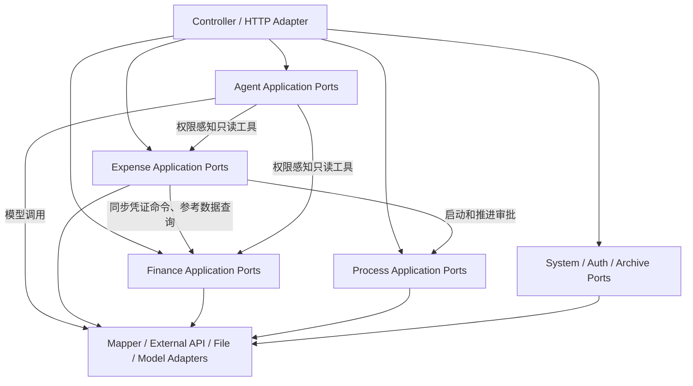

# FinEx 报销与财务协同系统最终目标与开发架构规范

**文档版本**：v2.0  
**生效日期**：2026-09-17  
**状态**：Active  
**审查基线**：当前工作区，包括尚未提交、未跟踪的 Agent 与业务改动  
**审阅周期**：每季度，或重大边界/安全变更完成后立即复查  

---

## 一、文档定位与状态定义

本文档是 FinEx 的最高产品架构与开发约束。它定义最终目标、当前事实、演进边界和质量门禁，但不把尚未实现的设计写成已经存在的能力。

文中使用以下状态：

| 状态 | 含义 |
| --- | --- |
| **当前事实** | 已由当前代码、配置、数据库脚本或测试证明 |
| **目标架构** | 系统要演进到的状态，不代表已经实现 |
| **强制规则** | 所有新增和修改必须遵守；遗留例外需显式记录 |
| **触发条件** | 只有条件成立并形成决策记录后才实施 |

文档优先级：

```text
本规范
  ├─ 指导：当前实现架构图与演进路线图
  ├─ 指导：项目长期架构治理工作流
  └─ 指导：各专项审查和治理方案
```

若专项文档与本规范冲突，以本规范为准；若本规范与实际代码不一致，必须明确记录为“目标”或修正文档，禁止用文档覆盖事实。

---

## 二、产品目标与范围

### 2.1 产品愿景

FinEx 面向 50～500 人的中小企业，提供报销、审批、付款、凭证、总账、固定资产、档案和智能协助的一体化能力。

核心价值：

1. 报销申请、审批、付款和凭证生成形成可审计闭环。
2. 报销与财务共享明确的数据契约，不重复维护业务真相。
3. 流程和表单可配置，但配置不能绕过权限和业务不变量。
4. Agent 作为智能增强层，通过受控工具使用业务能力，不直接操作业务数据库。

### 2.2 核心域

#### Expense：报销管理

- 报销单创建、草稿、提交、审批、撤回、支付和异常处理。
- 报销明细、附件、OCR、发票、收款方、关联与核销。
- 报销付款和凭证推送编排。
- 报销查询、统计和用户可见范围。

#### Finance：财务管理

- 凭证录入、保存、审核、记账、冲销和归档。
- 账套、会计期间、期初余额、期末结转。
- 总账、明细账、序时账、辅助账和报表。
- 固定资产、财务档案、科目、客户、供应商和项目。

#### Process：业务审批与表单流程

- 流程模板、版本、节点、路由和审批人解析。
- 表单、费用明细和自定义档案设计。
- 审批任务、抄送、付款节点及业务状态流转。

#### Agent：智能增强

- Agent 定义、版本、发布、运行和日志。
- 对话、模型路由、工具调用、流程编排和数字员工。
- 外部模型调用前的数据脱敏与结果还原。
- 企业知识库和业务本体属于目标能力，未落地部分不得标记为已完成。

#### System/Auth/Archive：系统支撑

- 公司、部门、员工、角色、权限、配置和通知。
- 登录、JWT、用户身份和权限校验。
- 发票、文档、打印、下载和归档。

### 2.3 明确不做或暂不做

- 当前不做多租户 SaaS；部署级 `tenantId` 不得代替公司级数据隔离。
- 当前不拆分业务微服务。
- 当前不建设采购、库存、销售、薪酬或合同全业务套件。
- 当前不合并 Process 审批工作流和 Agent 工具/LLM 工作流。
- 当前不因“技术先进”而默认引入 Redis、RabbitMQ、Kafka 或 APM 产品。

### 2.4 非功能目标

以下为目标，不代表已经通过压测或监控证明：

| 维度 | 目标 |
| --- | --- |
| 峰值请求 | 50 QPS |
| 页面首屏 | 正常网络与目标终端下小于 2 秒 |
| 常规接口 | P95 小于 500ms |
| 万级报表 | 小于 5 秒，超出时采用异步下载 |
| 可用性 | 月度 99.9% |
| 数据 | 核心事务不丢失，可审计、可追查 |

任何性能结论必须注明数据量、环境、查询、并发和采样时间。

---

## 三、当前架构事实与目标架构

### 3.1 当前事实

当前仓库包含 Maven 父工程、`common`、`gateway` 和承载绝大部分业务的 `auth-service`。业务代码主要仍按 `controller/service/dto/entity/mapper` 技术层组织，Expense、Finance、Process、Settings 等真相集中在 `service.impl` 的逻辑子包中。

因此当前最准确的定义是：

> 单一业务部署模块中的逻辑分域，正在演进为可验证的模块化单体。

当前还不能宣称已经完成：

- 独立的领域 Maven 模块。
- 完整的 `domain/application/infrastructure` 包隔离。
- 自动化的领域无环依赖检查。
- 可量化的 70% 测试覆盖率。
- Redis、消息队列或全局 APM。

### 3.2 目标架构



目标是清晰端口和单向依赖，不是为了形式创建大量空接口。已有能力型 Service 可以直接承担应用端口，只有在跨域依赖或适配器替换需要时才新增端口。

### 3.3 演进原则

- 保持单部署和数据库事务优势，先把逻辑边界变得可验证。
- 冻结遗留大入口，新业务进入明确 owner；旧入口仅兼容委派。
- 每次只迁移一个可验证切片，不进行大爆炸式包迁移或领域重写。
- 对外 API、数据库结构、权限码和用户流程默认保持兼容。
- 只有真实部署和团队边界需要独立发布时，才评估微服务。

---

## 四、领域职责与公共接口

### 4.1 使用现有能力型接口

当前公共边界以真实存在的接口为准：

| 领域 | 代表接口 | 主要职责 |
| --- | --- | --- |
| Expense | `ExpenseDocumentService` | 报销单、审批、支付相关应用入口 |
| Expense | `ExpenseVoucherGenerationService` | 报销凭证映射、推送和查询 |
| Finance | `FinanceVoucherService` | 凭证查询、保存、审核、记账 |
| Finance | `FinanceContextService` | 公司、账套和期间上下文 |
| Finance | `FinanceOpeningBalanceService` 等 | 按财务能力拆分的应用接口 |
| Process | `ProcessFlowDesignService` | 流程设计与发布 |
| Process | `ProcessManagementService` | 模板、费用类型和流程管理 |
| Agent | `ArchiveAgentService` | Agent 定义、发布、运行和记录 |

禁止为了文档对称性创建宽泛的 `ExpenseService`、`FinanceService`、`ProcessService` 或 `AgentService` 巨型门面。

### 4.2 Expense 边界

Expense 拥有：

- 报销单、明细、附件、支付、关联、核销和报销状态。
- 报销可见范围和审批/支付应用编排。
- 报销凭证映射规则和推送批次记录。

Expense 可以：

- 调用 Process 端口启动或推进审批。
- 调用 Finance 同步命令创建凭证。
- 调用 Finance 查询端口获取科目、项目等参考数据。

Expense 不可以：

- 直接读写 Finance Mapper 或表。
- 绕过 Process 任意修改审批任务状态。
- 复制 Finance 的凭证校验和编号规则。

### 4.3 Finance 边界

Finance 拥有：

- 凭证及凭证行、账套、期间、科目、余额、账簿和财务档案。
- 凭证编号、平衡、审核、记账和关账规则。

Finance 不直接修改报销单。创建凭证成功后的通知、审计和统计可以通过提交后事件完成，但核心凭证创建保持同步，确保调用方立即获得明确结果。

### 4.4 Process 边界

Process 拥有审批流程模板、版本、节点、路由、审批人解析和任务状态。Process 可以回调业务端口或返回状态迁移结果，但不得直接修改 Expense/Finance 业务表。

Process Workflow 与 Agent Workflow 保持独立：

- Process 的节点具有审批、抄送、付款、人员解析和业务状态语义。
- Agent 的节点具有 LLM、工具、条件和运行上下文语义。
- 两者只能复用不含业务语义的图校验、拓扑和画布基础能力。

### 4.5 Agent 边界

Agent 是智能增强层，不是独立产品，也不是业务数据超级管理员。

强制规则：

- Agent Tool 通过受控应用端口访问业务数据。
- Agent Tool 不依赖 Expense、Process、Finance Mapper 或业务 Entity。
- 查询端口在服务端执行用户、公司、权限、所有权和软删除过滤。
- Tool 返回最小化读模型，模型输入再执行脱敏。
- Agent 不绕过 Process 修改审批状态，不绕过 Finance 创建或修改凭证。
- Agent 自身定义、版本、运行和会话可以使用 Agent 域内 Mapper。

### 4.6 目标端口形态

以下为演进方向，不要求本轮立即创建所有接口：

```java
public interface ExpenseAgentQueryPort {
    ExpenseAgentQueryResult queryAccessibleDocuments(
            Long userId,
            String companyId,
            ExpenseAgentQuery query
    );
}

public interface FinanceReferenceQueryPort {
    List<FinanceAccountOption> listAccountOptions(String companyId);
}
```

现有 `FinanceVoucherService.saveVoucher()` 继续承担同步凭证命令。只有当调用方和实现方需要独立演进时，才提取专门的命令端口。

---

## 五、请求身份、公司隔离与追踪

### 5.1 身份模型

Web 边界必须从已验证 token 和数据库用户记录得到真实请求身份：

```text
RequestIdentity
├─ userId
├─ username
└─ companyId

RequestTrace
└─ correlationId
```

部署级 `tenantId` 在单租户私有部署中可以是常量，但不得替代 `companyId`。

### 5.2 强制规则

- token 只证明登录身份；公司和权限以服务端可信数据为准。
- 不接受客户端任意指定公司后直接作为数据过滤条件。
- Service 默认显式接收用户/公司参数，便于测试和审计。
- ThreadLocal 只在请求适配层或日志关联层使用，并在 `afterCompletion/finally` 中清理。
- 异步执行必须显式传递身份快照，不依赖线程池继承。
- 上下文缺失或非法时拒绝请求，不允许敏感接口静默回退公司 `1`。

### 5.3 兼容迁移

- 迁移期保留现有 request attribute 和 Service 参数。
- 先修正 Agent 拦截路径与真实公司加载，再逐步移除重复身份读取。
- 每一步都覆盖多公司、无权限、无公司、异步任务和线程清理测试。

---

## 六、技术栈基线

### 6.1 后端当前事实

| 领域 | 当前版本/选择 | 规则 |
| --- | --- | --- |
| Java | 17 | 编译和运行基线 |
| Spring Boot | 3.1.6 | 升级需单独 ADR 和全量回归 |
| Spring Cloud | 2022.0.5 | 与 Boot 兼容性一并评估 |
| MyBatis-Plus | 3.5.5 | 当前 ORM/Mapper 基线 |
| MySQL | 8.x | 主数据库目标版本 |
| Jackson | Spring Boot 管理 | 统一注入 `ObjectMapper` |
| JUnit/Mockito | Spring Boot Test 管理 | 后端测试基线 |
| Lombok | 1.18.30 | 当前正式使用，不做无收益全量移除 |
| Hutool | 5.8.23 | 当前在 common/auth 使用，淘汰需迁移计划 |

当前约 531 个 Java 文件使用 Lombok、22 个文件使用 Hutool。规范不得一边声明全面禁用，一边让主代码依赖它们。

强制规则：

- 不引入第二套 JSON 库；新增 JSON 逻辑使用 Spring Jackson。
- 新代码优先 `java.time`；遗留 `Date` 迁移需保持数据库和 JSON 兼容。
- Lombok 可用于稳定、清晰的数据样板；复杂领域对象避免隐式生成危险的 `equals/hashCode/toString`。
- Hutool 新使用必须证明标准库或现有封装不能满足；是否淘汰由独立依赖治理决定。
- 任何大版本升级必须包含兼容清单、回滚和生产构建验证。

### 6.2 前端当前事实

| 领域 | 当前版本/选择 | 规则 |
| --- | --- | --- |
| Vue | 3.5.x | Composition API 基线 |
| TypeScript | 5.9.x | `vue-tsc --build` 必须通过 |
| Pinia | 3.x | 共享状态按需要使用，不强制页面状态入 Store |
| Vue Router | 5.x | 路由元数据和权限保持集中 |
| Element Plus | 2.13.x | 唯一主 UI 组件库 |
| Vite | 7.x | 当前构建工具 |
| Vitest | 3.x | 单元/组件测试基线 |
| ESLint/Oxlint/Prettier | 当前配置 | lint 与格式化职责分离 |

强制规则：

- 不引入第二套主 UI 组件库。
- API 请求统一经过 `src/api/modules/core.ts`。
- 保留“能力模块 + `*-types.ts` + `@/api` barrel”结构。
- 页面内状态优先 composable；只有跨页面共享和持久生命周期状态才进入 Pinia。

### 6.3 条件型基础设施

| 能力 | 当前决策 | 触发条件 |
| --- | --- | --- |
| Redis | 不默认引入 | 多实例共享、明确性能瓶颈或一致性需求 |
| RabbitMQ/Kafka | 不默认引入 | 跨进程可靠异步，并具备 outbox、幂等、重试和运维能力 |
| APM | 后置选型 | 先完成关联 ID、结构化日志和核心指标 |
| JaCoCo | 建议 P2 引入 | 用于形成真实覆盖率基线 |
| Testcontainers | 按关键事务引入 | 数据库行为无法由 Mock 可靠验证 |

---

## 七、编码与边界规则

### 7.1 命名

- 类名应表达业务职责，如 `ExpenseAmountCalculator`、`VoucherBalanceValidator`。
- `Support` 不是绝对禁止词，但新增时必须有明确 owner、输入输出和边界，不能成为通用杂物箱。
- 遗留 `Abstract*Support` 冻结新增业务入口，逐步下沉到专属 owner。
- 不为追求后缀统一进行无业务收益的批量重命名。

### 7.2 验证职责

- DTO：必填、长度、格式、数值范围。
- 应用/领域 owner：权限、状态机、跨字段关系、数据库约束和幂等。
- 数据库：唯一性、非空、外键或等价一致性约束。
- 前端验证用于用户体验，不能代替服务端验证。

### 7.3 JSON

- 使用 Spring 注入的 `ObjectMapper`，禁止在业务类中自行创建默认 Mapper。
- 不建设静态全局 `JsonUtil`。
- 动态 JSON 必须定义 schema/version 或兼容读取策略。
- 金额使用 `BigDecimal`，禁止通过浮点数往返。

### 7.4 异常与 API 错误

统一响应至少包含稳定错误码、用户可见消息和关联 ID。迁移期允许 `GlobalExceptionHandler` 兼容映射遗留异常，但新增业务规则必须使用可测试的错误码。

禁止：

- 吞异常后返回成功。
- 向前端暴露 SQL、堆栈、密钥或模型原始敏感响应。
- 仅靠中文字符串判断错误类型。

### 7.5 事务

- 事务边界放在应用用例，而不是 Controller。
- 不在一个事务中吞掉已将事务标记为 rollback-only 的异常后继续宣称部分成功。
- 批量“允许部分成功”必须采用每项独立事务或明确的保存点策略，并有数据库集成测试。
- 外部网络调用原则上不长时间占用数据库事务；需要一致性时使用状态机和可重试记录。

---

## 八、安全基线

### 8.1 凭据

- Token、数据库密码、API Key、私钥不得进入 Git。
- 凭据必须有创建、最小权限、轮换、撤销、过期和泄漏处置流程。
- 发现已提交凭据时先撤销/轮换，再删除文件；删除文件不能替代轮换。
- Git 历史清洗会影响全部协作者，必须单独审批和协调，禁止在普通治理批次中自动执行。
- 提交前和 CI 应启用 secret scanning；日志必须遮蔽敏感值。

参考：[OWASP Secrets Management Cheat Sheet](https://cheatsheetseries.owasp.org/cheatsheets/Secrets_Management_Cheat_Sheet.html)。

### 8.2 密码

- 目标编码：Spring `PasswordEncoder` + bcrypt cost 12。
- 新增和修改密码只保存 bcrypt。
- 遗留 MD5 在登录验证成功后立即重哈希，迁移期不得一次性使全部用户失效。
- 财务敏感操作与登录复用相同 PasswordEncoder。
- 迁移完成并确认无遗留哈希后删除 MD5 分支。

参考：[OWASP Password Storage Cheat Sheet](https://cheatsheetseries.owasp.org/cheatsheets/Password_Storage_Cheat_Sheet.html)。

### 8.3 Agent 数据安全

- 业务数据离开本地边界调用云模型前必须执行数据分类和脱敏。
- 脱敏映射按用户、公司、会话和有效期隔离。
- 模型输出还原前验证映射归属，禁止跨会话/跨公司还原。
- Agent 工具遵守最小权限，不因“只读”而跳过授权。

---

## 九、架构护栏

### 9.1 ArchUnit 适用范围

ArchUnit 只检查字节码可验证的依赖规则：

- Controller 不直接依赖 Mapper。
- Controller 原则上依赖应用 Service/端口，不依赖具体 `service.impl`。
- Agent Tool 不依赖 Expense/Process/Finance Mapper。
- 端口接口不依赖 Controller 或基础设施实现。

当前技术分层包不适合直接按 `com.finex.auth.(*)..` 执行领域无环。启用领域无环前，必须先建立明确领域包或模块描述。

### 9.2 文件体量

文件行数由 Checkstyle、ESLint 或仓库脚本检查，不使用 ArchUnit 伪造源码行数规则。

| 类型 | 新文件推荐 | 需评审 | 禁止新增 |
| --- | ---: | ---: | ---: |
| Java | 不超过 500 行 | 500～1000 行 | 超过 1000 行 |
| Vue/TypeScript | 不超过 500 行 | 500～800 行 | 超过 800 行 |

现有超限文件进入版本化白名单：

- 不因白名单强制一次性拆分。
- 禁止无理由继续增大。
- 每次触达时评估是否提取独立 owner。
- 白名单只能缩小，不能无评审扩大。

### 9.3 覆盖率

“核心逻辑 70%”是目标而非当前事实。接入 JaCoCo/前端 coverage 并形成稳定基线后，采用“新代码不降低覆盖率、关键状态机必须有分支测试”的渐进门禁。

### 9.4 文档漂移

每次季度审查重新计算文件数、热点和测试结果。禁止复制旧数字作为当前事实。文档中的技术版本必须来自 POM、`package.json` 和 lockfile。

---

## 十、测试与交付门禁

### 10.1 当前事实

2026-09-17 当前工作区：

| 检查 | 结果 |
| --- | --- |
| 后端全量测试 | 739 个；6 failures、11 errors |
| 前端单测 | 655 个；59 failures |
| 前端类型检查 | 2 errors |

失败数不等于生产缺陷数。必须区分：

- 产品行为回归。
- 测试夹具或构造器漂移。
- 环境污染和配置隔离问题。
- 单一 Mock/共享依赖造成的级联失败。

恢复绿色基线是 P0，在此之前不得启动非安全止血类的大规模重构。

### 10.2 固定验证顺序

后端：

```text
1. mvn -pl auth-service -am -DskipTests compile
2. focused tests
3. mvn -pl auth-service -am test
```

前端：

```text
1. npm run type-check
2. focused tests
3. npm run test:unit
4. npm run build
```

### 10.3 高风险变更验收

| 变更 | 必须覆盖 |
| --- | --- |
| 密码迁移 | 新旧哈希登录、登录后升级、改密、敏感操作、并发更新 |
| 公司上下文 | 多公司、无公司、越权公司、异步执行、ThreadLocal 清理 |
| Agent 查询端口 | 所有权、待办、权限、软删除、公司隔离、结果不扩大 |
| 凭证批量事务 | 全成功、单项失败、数据库异常、部分成功、重试、重复推送 |
| Support 提取 | API、事务、状态、JSON 和错误消息兼容 |

---

## 十一、开发与发布流程

### 11.1 分支模型

当前仓库以 `main` 为主，不存在长期 `develop`。默认流程：

```text
main
  ├─ feature/<name>
  ├─ bugfix/<name>
  ├─ refactor/<name>
  └─ codex/<name>

短生命周期分支 -> review -> main -> release tag
```

如果未来确需 release/develop 分支，必须先定义发布节奏、回合并责任和自动化门禁，不在文档中凭空宣布存在。

### 11.2 每批治理流程

1. 重新验证事实基线。
2. 选择一个主热点，定义 owner、入口、兼容契约和禁止依赖。
3. 先补 characterization tests。
4. 小步迁移并保持旧入口委派。
5. 完成 focused、full、type-check/build 验收。
6. 更新边界文档和白名单。
7. 重新排序下一批，不机械沿用旧清单。

### 11.3 发布要求

- 全部门禁通过；若有批准的已知失败，必须记录 owner、影响和到期日。
- 数据库脚本幂等、可审查，并有备份/回滚策略。
- 配置变更列出新增环境变量、默认值和生产必填项。
- 安全凭据通过外部安全渠道配置，不写入发布包或文档示例。
- 重大边界变更必须有 ADR 或等价决策记录。

---

## 十二、治理优先级

### P0：安全与正确性止血

1. 轮换并移除版本库中的有效令牌，增加 secret scanning。
2. 设计并实施 MD5 到 bcrypt 的兼容迁移。
3. 修复 Agent 拦截路径、真实用户公司解析和缺失上下文拒绝策略。
4. 修复后端测试、前端单测和类型检查，恢复绿色基线。

### P1：边界和可观测性

1. Agent 业务查询改为权限感知端口。
2. Expense 的 Finance 参考数据改为查询端口。
3. 明确并验证凭证批量部分成功事务。
4. 统一 HTTP/异步任务关联 ID、结构化日志和核心指标。
5. 消除两处手工 `ObjectMapper`。

### P2：持续演进

1. 按热点评分继续 owner 提取。
2. 接入真实覆盖率工具并建立增量门禁。
3. 渐进建立领域包和依赖白名单。
4. 以指标驱动性能、缓存和报表优化。
5. 每季度审查技术版本、测试和文档漂移。

### 条件治理/当前禁止

| 项目 | 决策 |
| --- | --- |
| Redis | 性能、多实例或一致性证据成立后评估 |
| RabbitMQ/Kafka | 可靠跨进程异步需求和运维能力成立后评估 |
| 微服务拆分 | 团队、部署、容量和边界条件同时成立后评估 |
| Process/Agent 工作流合并 | 当前禁止 |
| 全量 Support 重写 | 当前禁止 |
| 前端 API 合并成领域巨型文件 | 当前禁止 |
| 全局静态 JsonUtil/万能 Validator | 当前禁止 |
| Git 历史清洗 | 单独审批并协调全部协作者后实施 |

---

## 十三、架构决策摘要

| ID | 决策 | 理由 |
| --- | --- | --- |
| ADR-001 | 保持单部署，演进为可验证模块化单体 | 当前规模和事务需求不支持微服务收益 |
| ADR-002 | Agent 保持相对独立但复用认证与业务端口 | 模型/编排独特，业务数据不能各自实现 |
| ADR-003 | Process 与 Agent Workflow 不合并 | 节点语义、状态机和运行目标不同 |
| ADR-004 | Expense 创建凭证保持同步命令 | 用户需要即时结果和清晰事务语义 |
| ADR-005 | 事件只承担提交后副作用 | 避免核心业务被最终一致性复杂化 |
| ADR-006 | 不建设静态 JsonUtil 和万能 Validator | 防止隐藏框架配置和领域语义 |
| ADR-007 | Redis/MQ/APM 均由触发条件驱动 | 目标规模下先测量再引入运维成本 |
| ADR-008 | 遗留热点采用冻结入口、逐刀提取 | 保持功能和接口兼容，控制回归面 |
| ADR-009 | 密码迁移使用 bcrypt 12 和登录后升级 | 在提升安全性的同时避免用户集中失效 |
| ADR-010 | 当前 API 与权限契约默认兼容 | 架构治理不能未经批准改变产品行为 |

---

## 十四、文档维护

- 本文只保存长期有效的目标、边界和规则；运行中的测试数字必须标注日期。
- 专项报告负责记录证据、问题清单、风险和批次决策。
- 每次新增领域、修改依赖方向、引入基础设施、改变公共 API 或完成重大重构时更新本文。
- Mermaid、代码示例和命令必须可执行或明确标记为目标形态。
- 其他文档仍出现 707/648 等旧基线时，应作为后续“文档链同步”待办处理，不能反向覆盖本文事实。

---

## 总结

FinEx 当前不是已经完成物理模块隔离的平台，也不是需要立即拆分的微服务系统。它是具备多个逻辑领域、已经开展渐进 owner 收口、但仍缺少自动边界约束的单一业务部署。

近期最高优先级不是 Redis、消息队列或统一工作流，而是：

1. 凭据和密码安全。
2. Agent 身份与公司隔离。
3. 绿色测试和类型基线。
4. Agent/Expense/Finance 的受控边界与事务正确性。

所有治理必须保持现有 HTTP API、权限码、数据库和用户业务流程兼容；任何破坏性迁移都需要独立决策、回归与回滚方案。

---

**文档负责人**：Architecture Team  
**下次复查**：P0 完成并恢复绿色基线后立即复查；其后按季度复查
